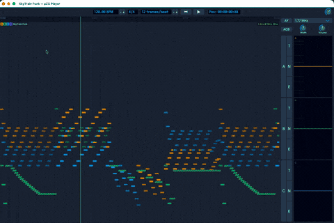

# μZX Player

[](https://github.com/Pixel-Matter/uZX/actions/workflows/ci.yml)
[](https://github.com/Pixel-Matter/uZX/releases?q=player-v&expanded=true)
[](LICENCE.md)
[](https://github.com/Pixel-Matter/uZX/releases)
[](https://en.cppreference.com/w/cpp/23)
[](https://juce.com/)
[](https://github.com/Tracktion/tracktion_engine/)

A player for AY-3-8910 / YM2149 chip music — ZX Spectrum, Amstrad CPC, MSX, Atari ST — that shows what the chip plays: each channel's notes, envelope and noise on a timeline, and a scope for each channel. macOS is the supported platform; the Windows and Linux builds are previews, unsigned and less tested.

```text
        █▌█▌█▌  █▌█▌█▌  █▌  █▌  █▌█▌█▌  █▌
        █▌  █▌    █▌      █▌    █▌█▌    █▌
  █▌█▌█▌█▌█▌█▌  █▌█▌█▌  █▌  █▌  █▌█▌█▌  █▌█▌█▌█▌
        █▌
                        |   |
    ,---.---.  ,---.  --|---|--  ,---.   ,---
    |   |   |       |   |   |   |    |  |
        |   |   ,---|   |   |   |---'   |
            |  |    |   |   |   |       |
               `---'    |   |    `---'
                        `-- `--
         ,--------.   ,---.
         `---/ / / \ / / /
            / / / \ ' / /
    B8   88  / /   / / /    Copyright 2025-2026
    B8   88   /   / / . \     pixelmatter.org
    B8.  88. /---/ / / \ \
    B8"oo""8o --'---'   `-'
    BP
```



## What it plays

- PSG register dumps (`.psg`), and Turbo Sound sets of two or three files as one tune
- TAYM files (`.taym`) with their timer effects: pulse-width modulation, sync-buzzer, samples
- ZX Spectrum tracker modules, through [zxtune](https://github.com/vitamin-caig/zxtune): Pro Tracker 1–3, Vortex Tracker II, Sound Tracker and Sound Tracker Pro, ASC Sound Master, SQ-Tracker, Pro Sound Creator, Pro Sound Maker, Global Tracker and Fast Tracker, Turbo Sound modules included
- μZX projects (`.uzx`)

Drop a file on the window, open it with **File → Open**, or double-click it in Finder. The chip is emulated with [ayumi](https://github.com/true-grue/ayumi).

## What it shows

- Each channel's notes on a scrolling timeline, with the envelope and noise drawn on them; A, B and C scopes and a level meter for each chip
- The tuning table and key the tune was written in, and its tempo, groove and meter, so the grid lines up with the tracker's rows
- **Viz mode**: the notes and scopes alone on the whole screen, in several layouts and two colour schemes
- **File → Render Video**: the same view as an MP4, through ffmpeg
- **Settings → Tuning Tables**: AY note tables in equal temperament and just intonation, each note playable

## What you can change

- The chip type and clock, the stereo layout, and each channel's tone, noise, envelope, mute and solo
- The frame rate, for a tune made for 100 or 200 Hz (see below)
- The loop range; scrub and step the playhead frame by frame

Each tune keeps its changes: open it again and they are back. **File → Save** writes them to a `.uzx` project.

## Download

Take the newest [Player release](https://github.com/Pixel-Matter/uZX/releases?q=player-v&expanded=true), tagged `player-v…`, and download `uZXPlayer-<version>-macOS.dmg`. Windows (`-windows-x64.zip`) and Linux (`-linux-x86_64.tar.gz`) builds are there too, unsigned and less tested; see [Installing on Windows](docs/user-guide.md#installing-on-windows) and [on Linux](docs/user-guide.md#installing-on-linux).

### macOS Setup

Open the `.dmg` and drag the app to **Applications**. The app isn't notarized by Apple, so the first launch needs **Open Anyway** in System Settings → Privacy & Security; see [Installing on macOS](docs/user-guide.md#installing-on-macos).

### Tunes at 100 or 200 Hz

Most `.psg` files don't record the frame rate they were written for, so μZX opens them at 50 Hz, and a tune made for 100 or 200 Hz (Atari, multi-speed players) plays two or four times too slowly. To play it at its rate:

1. Open the file as usual (`Cmd+O`).
2. Click **fps** in the transport bar and pick the rate, such as **200 fps**. Every clip that played at the old rate follows. A tune alone in the project takes its timeline along: its tempo scales with the rate (41 BPM at 50 Hz is 164 BPM at 200 Hz), keeping its rows, groove and meter.
3. Or right-click a clip and pick **Frame Rate** to change only that tune, all its Turbo Sound chips included.

The rate stays: the Player keeps it for that tune and brings it back when you open the tune again, and a `.uzx` project keeps it too. See [Opening Files](docs/user-guide.md#opening-files) in the User Guide.

## μZX Studio

The Player is the first app of a larger project. **μZX Studio**, the long-term main product, is an editor for writing AY music: a timeline of tracks and clips, MIDI played through chip instruments and effects into the emulated chip, tuning systems, and multiple chips. It is an early prototype of the core and the UI, not ready for testing yet; its `v…` releases are development snapshots.

μZX in turn is planned as the music subsystem of **MoTool**, a demotool for retrocomputer demoscene production. See the [Roadmap](docs/ROADMAP.md) and the [MoTool vision](docs/motool/vision.md).

## Building from Source

```bash
git clone --recursive https://github.com/Pixel-Matter/uZX.git
cd uZX
cmake -S . -B build -DCMAKE_BUILD_TYPE=Release
cmake --build build --config Release --parallel
```

This makes an optimised build, as releases are. With [Ninja](https://ninja-build.org) installed, the presets do the same: `cmake --preset release`, then `cmake --build --preset release --parallel`.

See [CONTRIBUTING.md](CONTRIBUTING.md) for detailed build instructions, prerequisites, and build targets.

## Documentation

- [User Guide](docs/user-guide.md) — everything in the Player, with all shortcuts; Studio and Tuning too
- [Roadmap](docs/ROADMAP.md) — planned features and release milestones
- [Design notes](docs/README.md) — tuning, PSG timing, parameter binding, and the index of all docs
- [Vision](docs/motool/vision.md) — the initial MoTool vision and long-term direction

## Known Issues

- **macOS: playback scrolling drops some frames on a MacBook Pro's built-in display.** On that XDR panel, at a fixed 50 Hz, about one frame in 25 reaches the screen a refresh late, so scrolling hitches now and then. Drawing a frame there takes about 10 ms, half of it macOS checking the picture for HDR content, which leaves little room before the screen's deadline. An external display is not affected. Before macOS 14 the timeline can also drop frames on other displays and in Viz mode, because there μZX can't time its frames to the screen.
- **macOS: with two displays on, playback scrolling stutters in waves.** When the displays refresh at slightly different rates, such as an external display at 59.95 Hz beside a MacBook's panel at 60 Hz, macOS shows some frames a refresh late for a few seconds every 20 seconds or so. μZX hands every frame over on time; the stutter comes from macOS. Using a single display, for example a MacBook with its lid closed, avoids it.

## Community

Join the [μZX Discord](https://discord.com/channels/1103598609804562463/1357634772666552340) for support, discussion, and to connect with other users.

## Contributing

Contributions are welcome! See [CONTRIBUTING.md](CONTRIBUTING.md) for build setup, code style, testing, and how to submit changes.

## Credits

- [Tracktion Engine](https://github.com/Tracktion/tracktion_engine/) — audio engine foundation
- [JUCE](https://juce.com/) — cross-platform C++ framework
- [ayumi](https://github.com/true-grue/ayumi) by Peter Sovietov (true-grue) — AY-3-8910/YM2149 emulation
- [Material Icons](https://github.com/google/material-design-icons) by Google — transport and device icons (Apache-2.0)
- [zxtune](https://github.com/vitamin-caig/zxtune) by Vitamin/CAIG — tracker module players (LGPL-3.0), built from the [uzx branch](https://github.com/Pixel-Matter/zxtune/tree/uzx) of our fork

Greets to diver, spke, n1k-o, bfox, wbcbz7, Pator, Megus, Volutar and all ZX Spectrum musicians and demosceners!


## About

See [AUTHOR.md](AUTHOR.md) for the story behind this project.

## License

[GPL-3.0](LICENCE.md)
