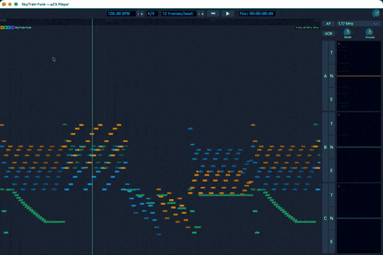

# µZX — Chiptune Music Tool

[](https://github.com/Pixel-Matter/uZX/actions/workflows/ci.yml)
[](LICENCE.md)
[]()

A modern tool for composing and playing back chiptune music for platforms using the AY-3-8910/YM2149 sound chips — ZX Spectrum, Amstrad CPC, MSX, Atari ST, and others. While the name references ZX Spectrum, the architecture is chip-agnostic and designed to support additional sound chips in the future. Built with JUCE, targeting macOS, Windows, and Linux, with iOS and Android possible. Features a timeline-based DAW interface with precise chip emulation.

```text
        █▌█▌█▌  █▌█▌█▌  █▌  █▌  █▌█▌█▌  █▌
        █▌  █▌    █▌      █▌    █▌█▌    █▌
  █▌█▌█▌█▌█▌█▌  █▌█▌█▌  █▌  █▌  █▌█▌█▌  █▌█▌█▌█▌
        █▌
                        |   |
    ,---.---.  ,---.  --|---|--  ,---.   ,---
    |   |   |       |   |   |   |    |  |
        |   |   ,---|   |   |   |---'   |
            |  |    |   |   |   |       |
               `---'    |   |    `---'
                        `-- `--
         ,--------.   ,---.
         `---/ / / \ / / /
            / / / \ ' / /
    B8   88  / /   / / /    Copyright 2025-2026
    B8   88   /   / / . \     pixelmatter.org
    B8.  88. /---/ / / \ \
    B8"oo""8o --'---'   `-'
    BP
```



## Features

**Three applications from one codebase:**

- **µZX Studio** — full-featured PSG music editor with timeline, instruments, and effects. Includes µZX Tuning.
- **µZX Player** — lightweight playback for `.uzx` projects and `.psg` files with drag-drop support, file associations, and keyboard shortcuts
- **µZX Tuning** — standalone tuning table editor for exploring chip tuning systems. (Included in µZX Studio as a built-in tool)

## Vision

µZX is being developed as the music subsystem of **MoTool** — a planned demotool for retrocomputer demoscene production. MoTool does not exist as a release yet; it will launch as a separate project on the shared codebase once the timeline supports video material and emulator integration. See [docs/motool/vision.md](docs/motool/vision.md) for the full picture.

**Music composition:**

- Timeline-based arranging with tracks, clips, and automation
- **Multiple chips** — add chip plugins to multiple tracks or load multiple PSGs to separate tracks for multi-chip compositions.
- ChipInstrument plugin with ADSR envelopes for AY chip
- MIDI to PSG conversion with configurable tuning systems
- Real-time AY-3-8910/YM2149 emulation via [ayumi](https://github.com/true-grue/ayumi)

**Tuning systems:**

- 12-TET, 5-Limit Just Intonation, and custom tuning tables
- Visual tuning grid with note tooltips and scale highlighting
- Configurable chip clock frequency and A4 reference
- CSV export of tuning tables
- Tuning table, key and tempo detection for imported PSG files, Turbo Sound sets as one tune

**Visualization & Interaction:**

- PSG clip display with notes, noise/envelope decoration, and note pitch scale
- Integrated oscilloscope displays per AY channel with live monitoring
- Standalone scope plugin
- Smooth timeline scrolling and zooming with click-to-seek
- Viz mode: full-screen notes and scopes, and File → Render Video to an MP4 through ffmpeg

## Download

See [Releases](https://github.com/Pixel-Matter/uZX/releases) for pre-built binaries.

### macOS Setup

If you encounter a quarantine warning when opening the app, clear it with:

```bash
xattr -rd com.apple.quarantine /Applications/μZX\ Player.app
xattr -rd com.apple.quarantine /Applications/μZX\ Studio.app
```

(Replace app paths as needed. Adjust for your installation location, e.g., `~/Applications/` if installed there.)

### Known Issues

- **macOS: playback scrolling drops some frames on a MacBook Pro's built-in display.** On that XDR panel, at a fixed 50 Hz, about one frame in 25 reaches the screen a refresh late, so scrolling hitches now and then. Drawing a frame there takes about 10 ms, half of it macOS checking the picture for HDR content, which leaves little room before the screen's deadline. An external display is not affected. Before macOS 14 the timeline can also drop frames on other displays and in Viz mode, because there µZX can't time its frames to the screen.
- **macOS: with two displays on, playback scrolling stutters in waves.** When the displays refresh at slightly different rates, such as an external display at 59.95 Hz beside a MacBook's panel at 60 Hz, macOS shows some frames a refresh late for a few seconds every 20 seconds or so. µZX hands every frame over on time; the stutter comes from macOS. Using a single display, for example a MacBook with its lid closed, avoids it.

## Building from Source

```bash
git clone --recursive https://github.com/Pixel-Matter/uZX.git
cd uZX
cmake -S . -B build
cmake --build build
```

See [CONTRIBUTING.md](CONTRIBUTING.md) for detailed build instructions, prerequisites, and build targets.

## Documentation

- [User Guide](docs/user-guide.md) — everything in Player, Studio and Tuning, with all shortcuts
- [Roadmap](docs/ROADMAP.md) — planned features and release milestones
- [Design notes](docs/README.md) — tuning, PSG timing, parameter binding, and the index of all docs
- [Vision](docs/motool/vision.md) — the initial MoTool vision and long-term direction

## Community

Join the [µZX Discord](https://discord.com/channels/1103598609804562463/1357634772666552340) for support, discussion, and to connect with other users.

## Contributing

Contributions are welcome! See [CONTRIBUTING.md](CONTRIBUTING.md) for build setup, code style, testing, and how to submit changes.

## Credits

- [Tracktion Engine](https://github.com/Tracktion/tracktion_engine/) — audio engine foundation
- [JUCE](https://juce.com/) — cross-platform C++ framework
- [ayumi](https://github.com/true-grue/ayumi) by Peter Sovietov (true-grue) — AY-3-8910/YM2149 emulation
- [zxtune](https://github.com/vitamin-caig/zxtune) by Vitamin/CAIG — tracker module players (LGPL-3.0), built from the [uzx branch](https://github.com/Pixel-Matter/zxtune/tree/uzx) of our fork

Greets to diver, spke, n1k-o, bfox, wbcbz7, Pator, Megus, Volutar and all ZX Spectrum musicians and demosceners!


## About

See [AUTHOR.md](AUTHOR.md) for the story behind this project.

## License

[GPL-3.0](LICENCE.md)
