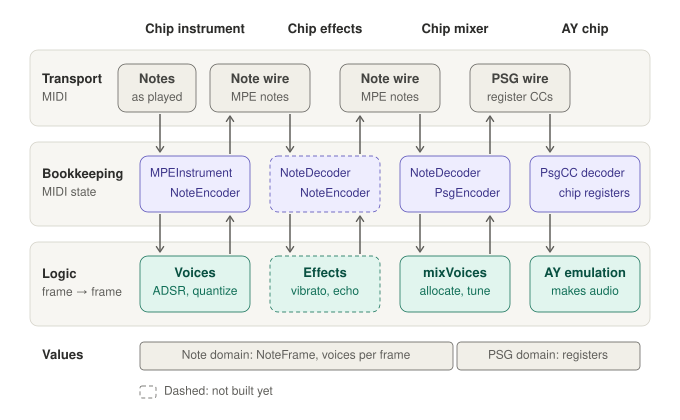
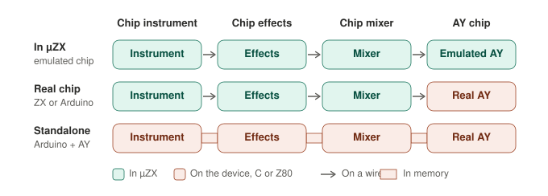

# MIDI to AY pipeline

> **Status: target design, partly implemented.** Both values with their encoders and decoders, and the chip mixer without voice allocation, are in the code; [What exists today](#what-exists-today) lists each stage and its gap. A voice's priority, voice allocation, the envelope voice as a timbre field, MPE output from the instrument and chip effects are not. The hardware setups in [Where the stages run](#where-the-stages-run) are a goal with nothing built.

How notes played on a keyboard or written in a clip become AY register writes. Code: `src/plugins/uZX/instrument/`, `src/plugins/uZX/midi_effects/`, `src/plugins/uZX/notes_to_psg/`, `src/plugins/uZX/aychip/`, `src/models/PsgCC.*`.

## Two domains

Plugins on a track talk to each other only through MIDI and audio, so everything between the keyboard and the chip travels as MIDI. That MIDI belongs to one of two domains, and most of the design is keeping them apart.

- **The note domain** is ordinary MIDI: notes and controllers from a keyboard, a clip, a looper or a sequencer, on any channels, possibly MPE or MIDI 2. Up to four notes sound at once on one chip, but nothing here knows that. **MIDI channels in the note domain are not AY channels.** A few controllers get a chip meaning later (envelope and noise modulation, noise pitch, oscillator shape); until the chip mixer they are still ordinary controllers.
- **The PSG domain** is the chip's registers, written as controllers on four MIDI channels: A, B, C, and one for the envelope and the noise. A PSG clip plays straight into this domain.

The chip mixer is the only stage that knows both.

## Stages

```
performance MIDI       chip-note stream (per frame)          PSG controllers
keyboard, clips, ─► instrument ─► chip fx ─► chip mixer ═══════════════► AY chip
loopers, MPE        ADSR,         vibrato,   voices → A/B/C/envelope,
                    quantize      arp, echo  priority, tuning
                                             PSG clip ─────────────────┘
                    └────── NoteFrame ──────┘└─────── PsgPatch ────────┘
```

| Stage | Takes | Gives | Does |
| --- | --- | --- | --- |
| Chip instrument | performance MIDI | chip-note stream | Plays the notes: applies ADSR and other per-note shaping, quantizes to the project or track frame rate. Stays in the note domain and its channel space; it does not produce PSG values |
| Chip effects | chip-note stream | chip-note stream | Echo, portamento, arpeggio, vibrato. Any number, in any order |
| Chip mixer | chip-note stream, all channels | PSG controllers | Assigns sounding voices to chip channels by priority, turns pitch into periods with the tuning, turns timbre into mixer and envelope bits |
| AY chip | PSG controllers | audio | Writes the registers |

**Performance MIDI** is events and gates: note on and off, velocity, whatever a keyboard sends. **The chip-note stream** is what the instrument has already played: for each frame, every sounding voice with its pitch, level and timbre stated outright. Gates, velocity and envelopes no longer exist in it, which is what makes it a simpler subset of MIDI that can be turned into PSG later.

Whether a playing mode or an effect lives inside the instrument or as a plugin of its own is a packaging choice, not an architecture one (see the next section). Where it goes in the chain follows from what it needs:

- An effect that needs the instrument's envelope to start again goes before the instrument, as an ordinary MIDI effect: a classic arpeggiator, note repeat.
- An effect that reshapes a voice that is already sounding goes after it: vibrato, portamento, tracker-style arpeggio and ornaments, echo.

Echo adds voices at a lower priority, and the mixer decides whether they get a chip channel.

## Two values, and the bookkeeping layer

Modular stages were meant to make development and testing easier. What defeated that was MIDI state bookkeeping mixed into every stage's logic: which notes are held, which note-off belongs to which note, what was last sent, what to do on a reset or a transport jump. The bookkeeping is therefore its own layer, written once, and stage logic never sees a MIDI message.

Each domain has one value and one codec:

| Domain | Value | Codec | State |
| --- | --- | --- | --- |
| Note | `NoteFrame`: the voices sounding in one frame. A voice has a channel, a pitch in fractional semitones, a level, a priority, and timbre fields (tone, noise and envelope mix, noise pitch, envelope shape) | Note codec: one voice per MIDI channel, MPE | In the shared decoder and encoder |
| PSG | `PsgPatch`: the PSG parameters set in one frame. A parameter that is set is written; a set envelope shape restarts the envelope, the same shape too, as a write of the register does on the chip. Today this is `PsgParamFrameData` | `PsgCC` | The chip's registers |

Every note-domain stage has the same shape:

```
MIDI in ─► decoder ─► NoteFrame ─► logic ─► NoteFrame ─► encoder ─► MIDI out
           shared                  the stage's own        shared
```

The decoder and encoder own everything that is about MIDI: held notes and their note-offs, per-note pitch and level, controller values, all-notes-off, transport jumps and resets, frame boundaries, what was last sent, and sending on a block with no input. After a reset or a jump the encoder forgets what it sent, so the next frame goes out whole.

`NoteFrame`, `NoteVoice`, `NoteEncoder` and `NoteDecoder` are in `src/plugins/uZX/midi_effects/NoteFrame.*`; `PsgEncoder`, which remembers what the chip was last sent, is in `src/models/PsgCC.*`. Two stages have this shape today:

- `MPEInstrumentFx`, an instrument, whose input is performance MIDI: JUCE's `MPEInstrument` and `VoiceManager` decode, each voice's `renderFrame` adds itself to the frame, and `NoteEncoder` sends what changed.
- `NotesToPsgMapper`, the mixer: `NoteDecoder` reads the stream, `mixVoices` turns a frame into the chip's parameters, and `PsgEncoder` sends what changed.

The chip-note stream carries its own frame grid: a frame is wherever the stream has messages, so a reader takes one after the messages of each time and adds no delay of its own.

All four stages by layer. In a bookkeeping box the upper name reads the wire and the lower name writes it; the chip writes nothing back, and its registers are its state. A PSG clip writes the PSG wire as the mixer does.



The logic owns only musical state: an envelope's phase, an LFO's phase, an arpeggio's step, an echo's history. Vibrato is `pitch += lfo(frame)`. Its test feeds frames and compares frames.

A plugin is then one decoder, a chain of frame functions, and one encoder, which is why "inside the instrument or a separate effect" stops mattering: the same function fits either.

## The chip mixer

The mixer takes the chip-note stream on all channels and produces one `PsgPatch` per frame:

- **Allocation.** More voices can sound than the chip has channels. Each voice carries a priority, by default its channel number, and the simplest policy is "higher channel number wins". Richer policies come when something needs them.
- **Pitch.** The tuning turns a voice's pitch into a tone period, or an envelope period for an envelope voice, at the clock of the chip the mixer plays on.
- **Timbre.** The voice's timbre fields become the tone, noise and envelope switches, the noise period and the envelope shape.
- **The envelope voice.** The chip has one envelope generator, and some voice's pitch has to set its period. The target is a timbre field on the voice that says "this voice's pitch drives the envelope", so any voice on any channel can be the envelope voice and the mixer picks among them by priority like any other. Until allocation exists, the voice on the fourth channel of the mixer's input range is the envelope voice, and it also carries the envelope shape and the noise period. The mixer writes the shape, which restarts the envelope, only when the voice asks for a restart: a note on that channel can start, move the envelope's pitch or last with the envelope running on.

`mixVoices` in `src/plugins/uZX/notes_to_psg/NotesToPsgMapper.*` is this function. A chip channel without a voice gets volume 0 and its envelope off. After an all-notes-off, a reset or a move to other MIDI channels the mixer silences the chip and forgets what it sent, so the next frame goes out whole: a chip that replaced another gets everything it needs.

## The wires

**Note wire, instrument to mixer.** MPE: one voice per MIDI channel, so pitch (pitch bend) and level (pressure) are per note. The instrument spreads a chord over its channel range. That caps the stream at sixteen voices before the mixer; MIDI 2 or an in-process path would replace only the note codec.

| A voice's | Travels as |
| --- | --- |
| Start and end | Note on, note off; a note on for a key that sounds starts it again |
| Level | Note-on velocity, then polyphonic aftertouch |
| Pitch | The pitch wheel of its channel, ±2 semitones from the key (`notePitchBendRange`) |
| Tone, noise, envelope on | Controllers 80, 81, 82 on its channel; on for any value but 0 |
| Envelope shape, noise period | Controllers 70 and 2 on its channel |
| Envelope restart | Controller 83 on the channel of the voice that plays the envelope, for any value but 0; another shape on controller 70 restarts too, since it cannot sound without a write |

A note clip or a keyboard can send the timbre controllers, and the mixer reads them. `NoteEncoder` does not write them yet, because nothing that makes frames sets a timbre. Controllers hold their value from note to note on a channel; a reset returns them to tone on, noise and envelope off.

**PSG wire, mixer or PSG clip to chip.** Implemented as `PsgCC` in `src/models/PsgCC.*`: one table that `PsgParamsMidiWriter` (PSG clips), the mapper and `AYChipPlugin` all use. Channels count from the chip's base channel.

| Parameter | Channel | Controller |
| --- | --- | --- |
| Volume A, B, C | 0, 1, 2 | 7 |
| Tone period A, B, C | 0, 1, 2 | 20 (7 high bits) and 52 (7 low bits) |
| Tone on A, B, C | 0, 1, 2 | 80 |
| Noise on A, B, C | 0, 1, 2 | 81 |
| Envelope on A, B, C | 0, 1, 2 | 82 |
| Retrigger tone A, B, C | 0, 1, 2 | 83 |
| Noise period | 3 | 2 |
| Envelope period | 3 | 20 and 52 |
| Envelope shape | 3 | 70 |
| Restart envelope | 3 | 83, pressed (1) and released (0) |

The envelope shape is the one parameter whose value and write travel apart, on this wire as on the note wire: on both, controller 70 is the shape and controller 83 the restart. In a `PsgPatch` a set shape is a write, and a write restarts the envelope. But MIDI sends a controller's value again where nothing was written: a clip's first frame restates everything the chip should hold, a clip that starts part-way through its frames (trimmed at its start, or the later part of a split) restates what the frames before it left, and Tracktion resends the last value of each controller when play starts inside a clip. So controller 70 is the shape as a value, and controller 83 is the restart. A write goes out as both; the chip writes the register on a restart, or when controller 70 brings another shape than it holds, and not when it brings the same one. The restart is released at once, so the value a host sends again is the released one. A tune cut into clips therefore keeps an envelope note running across the cut.

`PsgEncoder` sends a shape each time it is set, and everything else but a tone retrigger only when it differs from what was sent.

Both wires share a track's sixteen channels. Routing them apart is the user's business, as in any DAW; the safer default is the PSG wire on the last four channels (13–16), which leaves the low channels to notes. Today both the chip and MIDI to PSG default to base channel 1.

## Where the stages run

> **Only the first row exists.** The two hardware rows are a goal: live performance on a real chip. No firmware is written.



- **In µZX.** Every stage is a plugin on the computer, and the chip is emulated.
- **A real chip.** µZX runs the instrument, the effects and the mixer, and the PSG wire leaves the computer for a real AY: in a ZX Spectrum, or on an Arduino. The device needs a decoder and register writes, nothing else.
- **Standalone.** An Arduino with an AY runs the instrument, the effects and the mixer as well, ported to C, so a MIDI keyboard plays the chip with no computer. Inside one program the wires between the stages are not needed: one decoder reads the keyboard, the frame functions are called in a row, and the result is written to the registers.

What this asks of the design:

- **The PSG wire becomes a protocol** that firmware implements, so the wire changes in [Order of work](#order-of-work) come before any firmware.
- **The link to the device is a transport, and need not be MIDI.** Over a MIDI port the device decodes `PsgCC`. A 5-pin MIDI cable carries about 62 bytes per 50 Hz frame, 20 controller messages of three bytes; a whole frame after a reset is up to 24 and spills into the next frame, while an ordinary frame, where `PsgEncoder` sends only what changed, is far smaller. Over a serial link that only this pipeline uses (RS-232 into a Spectrum, USB serial into an Arduino) a second codec for the same value is the better fit: the registers that changed, as a mask and their bytes, 16 bytes a frame at most, where a shape in the mask is a write and needs no restart message. That fits 9600 baud (19 bytes per frame) and takes a few instructions to decode on a Z80. It is one more encoder in the bookkeeping row; the logic does not change.
- **Stage logic stays free of MIDI state**, so it ports in shape. The codecs take JUCE and Tracktion message types today and would be written again over raw bytes. No portability layer is built before a port starts.

## What exists today

| Target role | Today | Gap |
| --- | --- | --- |
| Chip instrument | `ChipInstrumentPlugin`, `ChipInstrumentVoice` on `MPEInstrumentFx` | Sends every voice on the channel its note came in on, so a chord's voices share one pitch wheel; sets no timbre; fixed 50 Hz (`noteFrameRate`) |
| Chip effects | None | |
| Chip mixer | `NotesToPsgPlugin`, `NotesToPsgMapper`, `mixVoices` | No allocation: it reads four MIDI channels from its base channel, channel n plays chip channel n (the last note to start, if several), and the fourth plays the envelope. Its PSG output goes out on the same four channels |
| PSG codec | `PsgCC`, `PsgEncoder` | An envelope period above 14 bits does not fit two controllers; a switch is 0 or 1 and volume the raw 0–15, not the 0–127 a knob sends |
| AY chip | `AYChipPlugin` | None: it decodes each frame's controllers over the registers the chip holds, and keeps nothing else |
| Tuning preview | `MultitrackMidiPreview` | Plays note clips with timbre controllers into the mixer, and counts on channel n being chip channel n and the fourth the envelope |

## Order of work

Refactor first, then change behaviour.

1. Voice allocation in the mixer: voices on any channel, assigned to chip channels by priority. With it, the envelope voice becomes a timbre field saying the voice's pitch drives the envelope, in place of the fourth channel, and the tuning preview stops counting on channel numbers.
2. MPE output from the instrument; timbre from the instrument, written by `NoteEncoder`; the PSG wire on the last four channels by default.
3. Chip effects.
4. Wire changes: a full 16-bit envelope period, one meaning for switch and volume values. These come before any firmware reads the wire.
