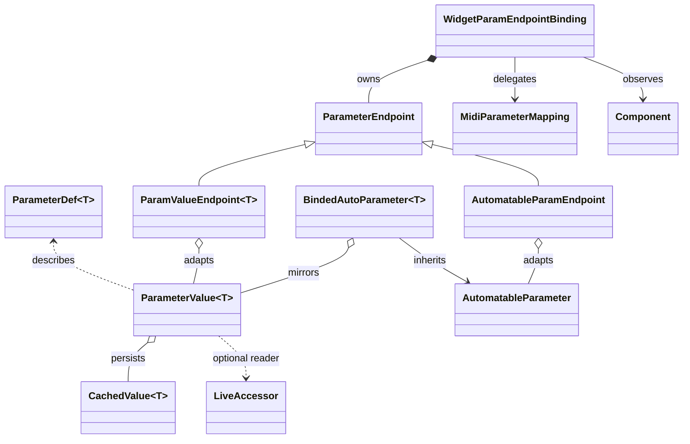

# Parameter Binding Architecture

The parameter subsystem ties together three concerns: structured metadata that defines a parameter, persistent storage in `juce::ValueTree`, and the live automation or UI surfaces that read and write it. The core types (`ParameterDef<T>`, `ParameterValue<T>`, the automation bridge, and the widget bindings) are designed so each layer can be composed without exploding into widget- or type-specific code.

## Parameter definitions (`ParameterDef<T>`)

- A `ParameterDef<T>` instance describes everything the UI or automation layer needs to present a value (`identifier`, `propertyID`, labels, description, units, `NormalisableRange`, default, formatting callbacks). See `src/controllers/Parameters.h`.
- Helpers such as `numberOfStates`, `floatToState`, `stateToLabel`, `decimalPlaces`, `valueToText`, and `textToValue` keep consumers from re‑implementing per-type logic (`src/controllers/Parameters.h`).
- Bool and `Util::EnumChoiceConcept` specialisations override the generic behaviour to provide meaningful labels and discrete state handling (`src/controllers/Parameters.h`).

## Conversion traits (`ParameterConversionTraits`)

- `ParameterConversionTraits<T>` map strongly typed values to the lightweight forms automation expects (float/string) and back (`src/controllers/Parameters.h`). They cover floats, integral types, bools, and `EnumChoice` wrappers, so the rest of the system stays templated while Tracktion/JUCE code continues to operate on floats or strings.

## Stored and live values (`ParameterValue<T>`)

- `ParameterValue<T>` bundles a definition with `juce::CachedValue<T>` so a parameter struct can call `.referTo(ValueTree, UndoManager)` and immediately mirror persistent state (`src/controllers/Parameters.h`).
- `getStoredValue*` accesses the cached state; `setStoredValue`/`setStoredValueAs` update it; `getPropertyAsValue` hands a `juce::Value` reference to `ParamEndpoint` listeners (`src/controllers/Parameters.h`).
- `LiveAccessor` + `setLiveReader` let automation (or other live sources) expose an up-to-date value without touching the `ValueTree`. If no live reader exists, `getLiveValue` falls back to the stored value (`src/controllers/Parameters.h`).
- `ParameterValueConcept` captures the requirements bindings use when accepting a generic parameter instance (`src/controllers/Parameters.h`).

## Automation bridge (`BindedAutoParameter<T>`)

- `BindedAutoParameter<T>` subclasses `tracktion::AutomatableParameter`, keeps the `ParameterDef<T>` metadata in sync, and registers itself as the live reader through `ParameterValue::setLiveReader` (`src/controllers/BindedAutoParameter.h`).
- It mirrors stored state into the automation lane via `updateFromAttachedParamValue`, and writes automation changes back into the `CachedValue` on the JUCE message thread using `AsyncUpdater` (`src/controllers/BindedAutoParameter.h`).
- Label/step helpers honour enum choices and discrete ranges, so automation editors display the same labels the UI does (`src/controllers/BindedAutoParameter.h`).
- `PluginBase::addParam` wraps the common pattern for Tracktion plug-ins, and `restorePluginStateFromValueTree` refreshes every registered parameter when an edit reloads (`src/controllers/BindedAutoParameter.h`).

## Unified parameter endpoints

- `ParameterEndpoint` abstracts everything widgets need: range, formatting, gestures, state/label helpers, and listener hooks (`src/controllers/ParamEndpoint.h`).
- `ParamValueEndpoint<T>` adapts a `ParameterValue<T>` to that interface by listening to its `juce::Value` for stored updates and querying the live reader when available (`src/controllers/ParamEndpoint.h`).
- `AutomatableParamEndpoint` wraps a `tracktion::AutomatableParameter`, forwarding gesture notifications and UI callbacks while staying responsive to automation playback (`src/controllers/ParamEndpoint.h`).
- `makeResolveParamEndpoint` picks the right endpoint automatically: an explicit automatable parameter beats the live reader, otherwise the binding falls back to pure stored access (`src/controllers/ParamEndpoint.h`).

## Widget bindings

- `WidgetParamEndpointBinding` owns a `ParameterEndpoint`, listens for stored/live changes, and exposes MIDI learn & RMB hooks via `MidiParameterMapping` and `MouseListenerWithCallback` (`src/gui/common/ParamBindings.h`).
- Specialisations such as `SliderParamEndpointBinding` and `ButtonParamEndpointBinding` configure widgets, wire UI callbacks to `ParameterEndpoint::setStoredFloatValue`, and refresh visuals when either stored or live values change (`src/gui/common/ParamBindings.h`).
- Convenience constructors accept either a `ParameterValue<T>` or an explicit `AutomatableParameter::Ptr`, so UI code can stay agnostic about which layer provides live feedback.

## Data flow

