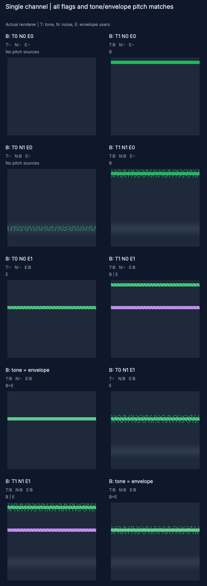
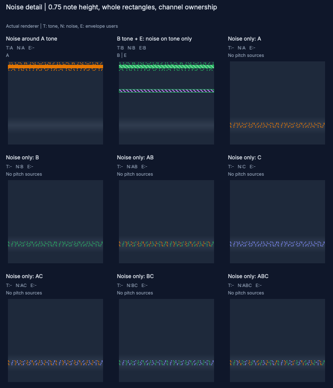
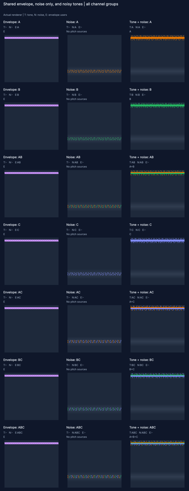
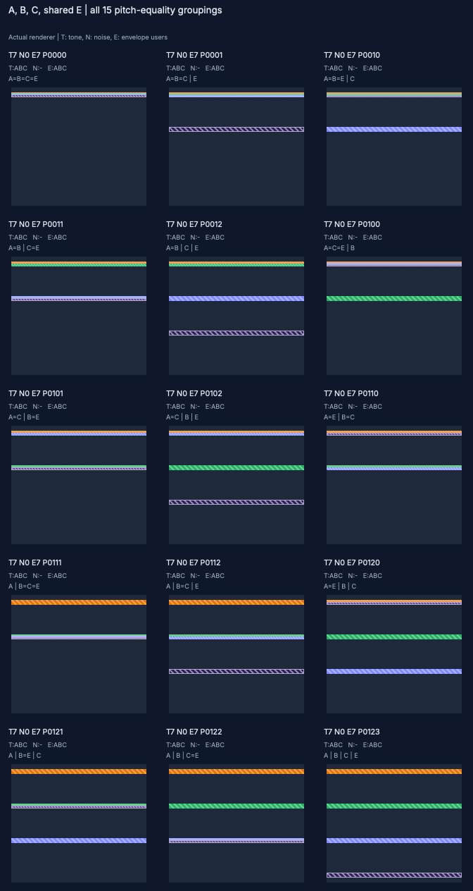
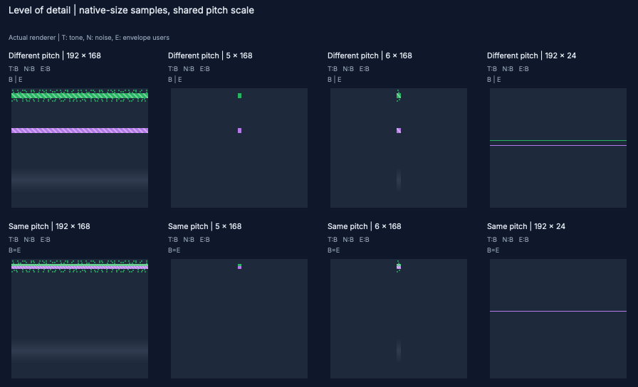
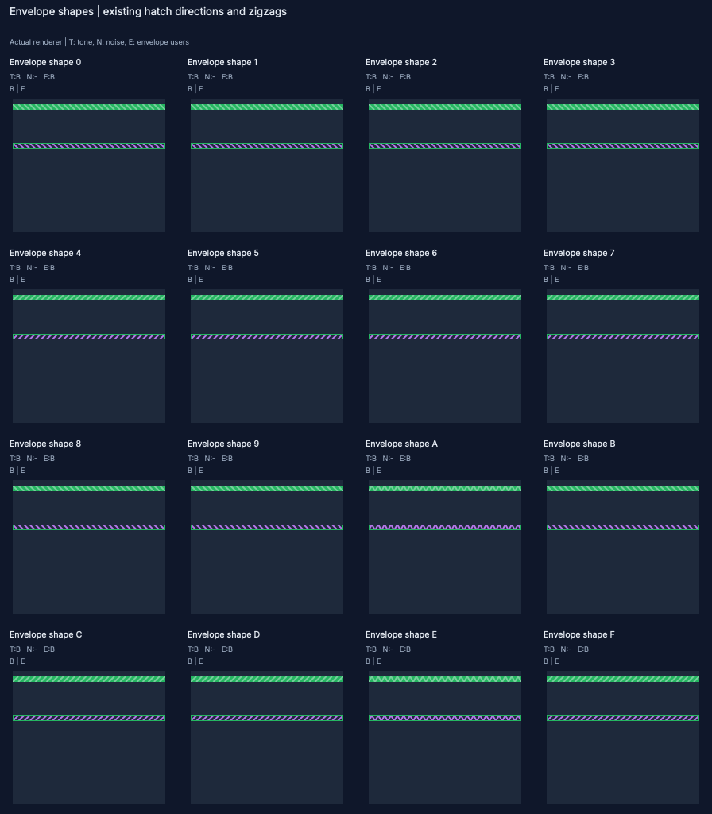
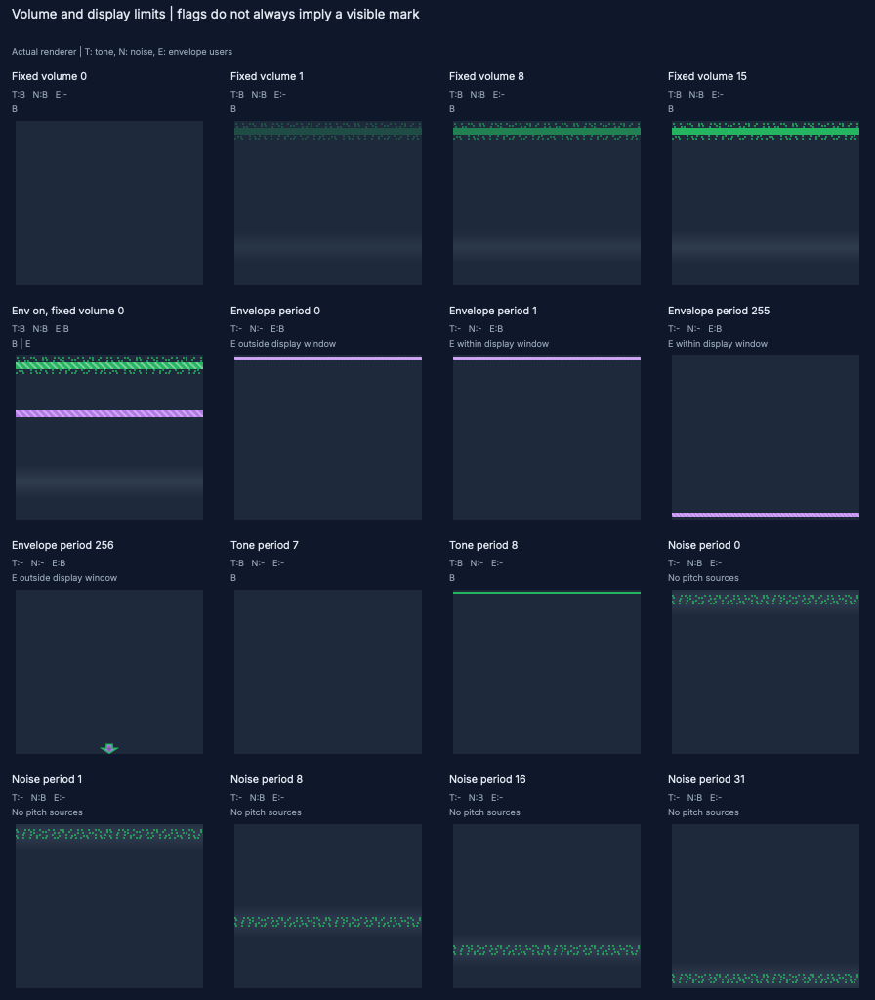
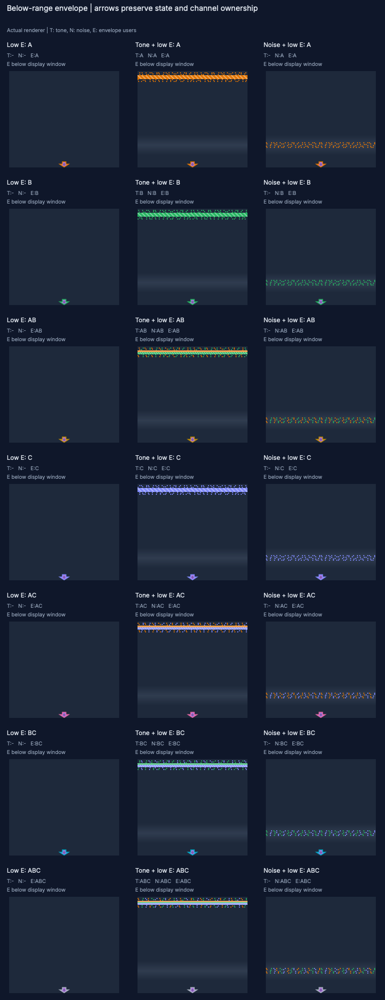

# Reading PSG clips

This is a visual reference for the PSG renderer, including its ambiguous cases. Regenerate the images when the renderer changes; see [Regenerate](#regenerate).

Each image is painted by `PsgClipComponent::paintNotes()`, the same code used in the application. The examples use synthetic register frames, not a recording or an audio simulation. Captions explain register state; they do not guarantee what you will hear.

## The visual vocabulary

| Mark | Meaning |
| --- | --- |
| Orange, green, blue-violet | Channel A, B, C |
| Filled channel-colored note | Tone pitch; opacity follows fixed volume |
| Filled note with brighter channel-colored hatching | Tone pitch with envelope-controlled volume |
| Envelope-colored note with brighter envelope-colored hatching | Shared envelope pitch |
| Faint gray band | Shared noise period |
| Channel-colored rectangles outside note silhouettes | Noise enabled on those visible pitch sources |
| Channel-colored rectangles around the noise-band center | Noise ownership when that channel has no visible pitched mark |
| Downward cross-hatched envelope-colored arrow with channel outline | Envelope is on, but its pitch is below the display window |
| Gray square fading upward/downward, labeled N | Noise-band legend sample |


The envelope color is purple. An envelope-controlled tone keeps its channel color. The separate envelope-pitch mark is a purple note with brighter purple hatching.

Hatching indicates envelope shape: attack-first shapes use rising diagonals, decay-first shapes use falling diagonals, and shapes A/E use zigzags. This is a shape cue, not a trace of the instantaneous envelope level. One-shot shapes also receive a schematic pitch mark when their period lies within the display window.

## One channel: every flag combination

`T` means tone enabled, `N` means noise enabled, and `E` means envelope-controlled volume. These examples use **channel B**, so channel-owned parts are green. The same rules apply to A and C with their respective colors.

| T | N | E | What the image means |
| --- | --- | --- | --- |
| 0 | 0 | 0 | No tone, envelope-pitch, or noise mark |
| 1 | 0 | 0 | Tone pitch only |
| 0 | 1 | 0 | Noise band with scattered channel-colored ownership rectangles |
| 1 | 1 | 0 | Tone pitch and noise band |
| 0 | 0 | 1 | Envelope pitch only; nothing shows that B uses it |
| 1 | 0 | 1 | Tone pitch and shared envelope pitch; they may match or differ |
| 0 | 1 | 1 | Envelope pitch and envelope-controlled noise |
| 1 | 1 | 1 | Tone pitch, shared envelope pitch, and noise |



`B=E` means the tone and envelope pitch coincide. `B | E` means they differ. The sheet includes both possibilities wherever tone and envelope are enabled together. Disabled sources have no pitch relationship to display.

In this flag sheet, envelope pitch stays fixed. The tone moves to meet it in the matching-pitch examples.

## Shared envelope and channel ownership

There is one shared envelope-pitch mark for all channels using the envelope. Two envelope-enabled channels with tone off produce **one E mark**, not two independent envelope pitches.

The E mark looks the same whichever channels use it. Its users show on their own marks: a tone with envelope-controlled volume is hatched, and a channel's noise decorates the E mark when that channel has no visible tone.

Noise ownership follows a per-channel priority:

1. With a visible tone pitch, noise is shown around that tone silhouette only.
2. Without a visible tone, a visible envelope-pitch mark receives its channel's noise decoration.
3. With neither pitched mark visible, the same rectangular stipple appears around the gray noise-band center, extending 0.75 of a note height upward and downward. It does not add a note silhouette.

The stipple uses whole 2×2 logical-pixel rectangles. Its decoration area extends 0.75 of a note height above and below the silhouette. Rectangle opacity follows channel level and stays uniform with distance from the silhouette or noise-band center. Marks that cannot fit fully inside the frame, viewport, spread area, or free space between notes are omitted rather than cut smaller. Coincident notes share one exterior fringe around their combined pitch row.

The pattern repeats deterministically. Only noise-enabled, nonzero-level channels contribute; zero fixed-volume channels contribute when their envelope is enabled. A channel with a tone and a separate envelope pitch does not decorate both. A shared envelope can still receive noise decoration from another owner whose tone is absent.

Noise-only channels retain the gray period band, with scattered rectangles in the actual A/B/C owner colors rather than an invented note pitch. Multiple owners share the repeating pattern positions; their colors are interspersed without blending. This sheet shows both note decoration and all seven noise-only owner groups.



The next sheet shows envelope ownership, noise alone, and noise around tones for all seven channel groups.



**Ambiguity:** a channel that uses the envelope with tone and noise both off leaves no mark of its own, so the E mark alone does not say which channels use it. They do not directly show individual owners as clearly as the channel-colored noise rectangles do.

## Matching and different pitches

The following sheet includes all **15 equality groupings** of A tone, B tone, C tone, and shared E pitch. An equals sign joins matching pitches; a vertical separator divides different pitches. For example, `A=B=E | C` means A, B, and E coincide, while C differs.



The renderer divides overlapping notes into thin vertical slices within the pitch row. Tone slices are painted before the envelope slice at an exactly matching pitch. If there is less than one pixel per slice, marks are painted on top of each other instead.

**Ambiguity:** the thin slices can lose their pattern. A picture may therefore fail to reveal every enabled source.

## Level of detail

Envelope hatching, the noise band, and outside-note noise rectangles are drawn only when both conditions hold:

- At least **6 pixels per PSG frame** horizontally.
- At least **2 pixels per note row** vertically, before overlap subdivision.

Tone fills and envelope-pitch outlines remain when details disappear. Outside-note rectangles require room for a full 2×2 mark within the configured spread above or below a silhouette; crowded neighbors can suppress them. The native-size samples below show the same states at normal detail, 5 px/frame, 6 px/frame, and a short lane. Narrow/short samples are centered in their panels without enlargement.



**Ambiguity:** at low detail, a channel-colored outline may resemble a filled tone line. Missing hatching or noise does not prove that the corresponding flag is off.

## Envelope shapes

All 16 shape values are shown with a tone and a different envelope pitch. Values with the same hatch direction can look identical; the renderer does not encode every shape bit in the pattern.



## Volume and display limits

- Fixed volume zero hides tone and noise when the envelope is off.
- Envelope-controlled tone remains visible with fixed volume zero. Envelope-controlled noise uses an estimated full level; this view does not follow instantaneous envelope phase.
- Tone periods below 8 are omitted as tone-pitch marks.
- Envelope pitch is mapped to the tone scale using `tone period = 16 × envelope period`. Period 0 produces no pitch mark. Periods 256 or greater are below the display window and show a bottom-edge downward arrow instead of a pitched E note.
- The below-range arrow has bold envelope-colored cross-hatching and a channel-colored outline. It indicates a clamped, lower pitch; its vertical position is not an exact pitch. At insufficient detail it reduces to a compact envelope-colored marker. It is not a silhouette for noise decoration: noise uses a visible tone, or falls back to stipple around the band center.
- Noise periods 0 and 1 share the same band position. Larger periods move the band downward. This band is a period indicator, not a measured spectrum.

The pitch-limit examples can extend the standard reference range, so their vertical scale can differ from the main sheets.



## Envelope below the display window

The arrow sits at the lower edge, below ordinary note silhouettes. Cross-hatching identifies this as an out-of-range indicator rather than an envelope-shape pattern. The three columns show envelope alone, tone plus low envelope, and noise plus low envelope, for every channel-owner group.



## Pitch range of the examples

All main examples share a pitch range fixed by an offscreen reference frame. That frame is excluded from painting. Equal source pitches are therefore comparable across cells, rather than being stretched independently to fill each picture.

## Regenerate

Regenerate one sheet (the second argument is its filename):

```sh
./tests/generate-psg-visual-guide.sh docs/images/psg-visualization noise-detail.png
```

Without the second argument the script renders every sheet. A full run also writes an exhaustive atlas (`atlas/`, 2,192 states across all 512 tone/noise/envelope flag combinations) and its `states.json` manifest next to the sheets; both are git-ignored, for looking up a confusing case locally. The optional first argument selects a different output directory. The script configures and builds `uZXTests`, then runs the `PsgVisualGuide` test with export enabled.

Without export enabled, `PsgVisualGuide` checks the full flag/equality matrix without writing image files:

```sh
build/src/uZXTests_artefacts/Debug/uZXTests PsgVisualGuide
```

The generator and painting regressions share [PsgClipTestHelpers.h](../src/gui/timeline/PsgClipTestHelpers.h); case definitions and export checks live in [PsgVisualGuide.test.cpp](../src/gui/timeline/PsgVisualGuide.test.cpp).

## Painting benchmark

An opt-in benchmark, [PsgPaintingBenchmark.test.cpp](../src/gui/timeline/PsgPaintingBenchmark.test.cpp), times cached `paintNotes()` calls (median and p95 of 51 warm samples) on JUCE's offscreen bitmap backend. It does nothing unless the variable is set, and it measures paint cost, not live frame times:

```sh
UZX_PSG_PAINT_BENCHMARK=/tmp/psg-paint.json build/src/uZXTests_artefacts/Debug/uZXTests PsgPaintingBenchmark
```

For live paint times in the app, start it with `UZX_PAINT_STATS=1` to draw each PSG clip's timing overlay.
