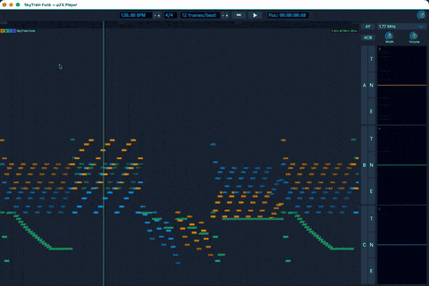
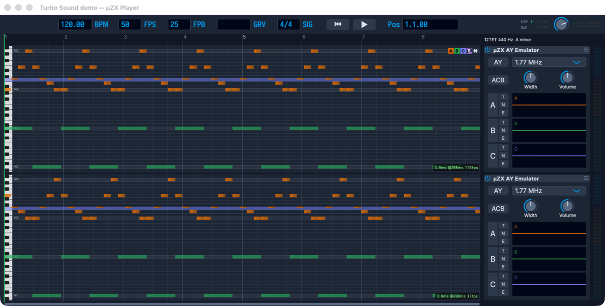
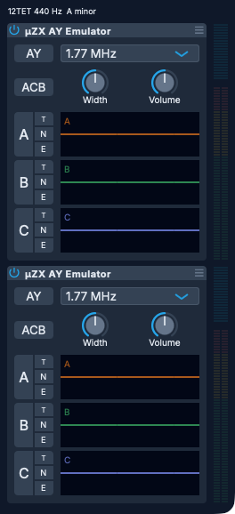
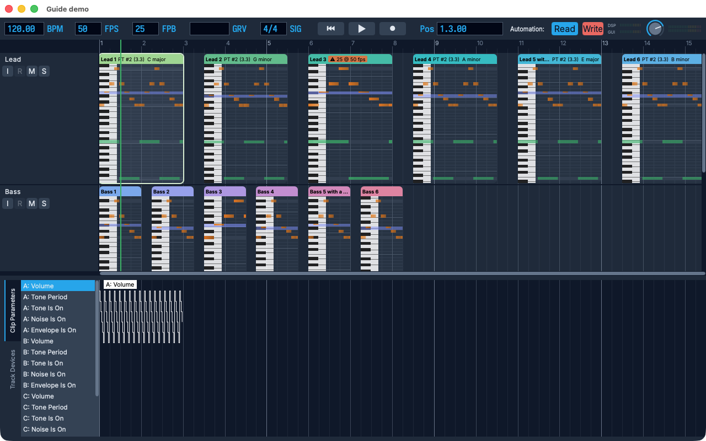
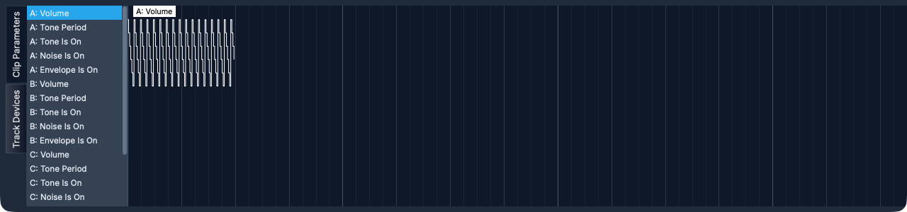
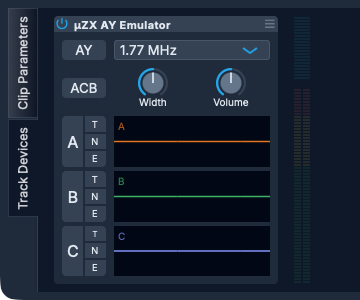
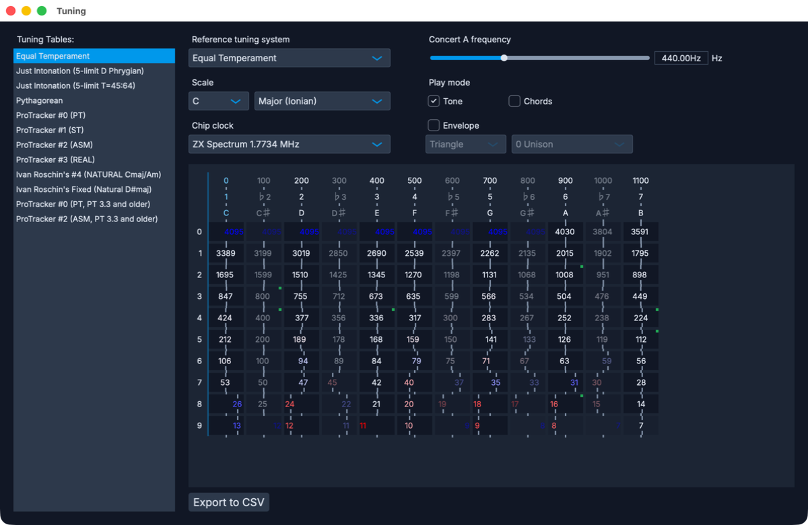

# µZX User Guide

µZX is a suite of applications for working with PSG chip music (AY-3-8910 / YM2149), targeting ZX Spectrum demoscene production.

The screenshots show the macOS build using the [Guide demo project](../tests/fixtures/Guide%20demo.uzx).

---

## Applications

| App | Description |
|-----|-------------|
| **µZX Studio** | Full-featured PSG music editor with timeline, instruments, and automation (Work in progress) |
| **µZX Player** | Lightweight player with visualization for `.psg` and `.uzx` files |
| **µZX Tuning** | Tuning table (note table) editor/viewer. Supports equal temperament and just-intonation |

---

## µZX Player

A minimal player for listening to PSG chip music files.

### Opening Files

- **Drag and drop** a `.psg` or `.uzx` file onto the window.
- **File menu → Open** (`Cmd+O` / `Ctrl+O`).
- **Double-click** a `.psg` or `.uzx` file in Finder / Explorer (file association registered on install).
- Pass a file path as a command-line argument.

Drop or open several `.psg` files at once to play them together, each on its own track with its own AY chip, as a Turbo Sound tune has one file per chip. They replace the open edit, which is named after the start their names share: `song_1.psg` and `song_2.psg` open as `song`.

**Turbo Sound sets.** When a single `.psg` file's name ends in a chip number 1 to 3 after `_`, `-`, `.` or a space (`song_1.psg`, or `song.1.psg` as Vortex Tracker exports them), and files with the other numbers lie next to it with as many frames and the same PSG header, µZX asks whether to open the whole set or only that file. This applies however a single file comes in: opening, dropping, Finder / Explorer, and **Import PSG** in both apps.

### Transport Bar

Located at the top of the window.

<!-- guide-figure:player-overview -->

The transport sits above the timeline; the AY controls are on the right.
<!-- /guide-figure:player-overview -->

| Control | Description |
|---------|-------------|
| Rewind (⏮) | Jump to the beginning |
| Play/Pause (▶/⏸) | Start or pause playback |
| Position readout | Current time; format switches between bars/beats and mm:ss |
| BPM control | Tempo in BPM (inc/dec buttons or direct entry). Importing a PSG into an empty project sets it from the detected tracker speed, together with the frames-per-beat grid; dumps without a clear row grid keep the current tempo. If a dump starts a few frames before its first tracker row, the clip is trimmed so that row starts bar 1, or, when those frames are not silent, moved right so it starts bar 2 |
| Groove (GRV) | Frame counts of the grid groups within one beat, such as 6 6 6 6, or 7 6 7 6 for a swing. Click and type your own. Importing a PSG into an empty project sets it from the detected rows, grouped four to a beat (three or five where the beat divides that way) |
| Time signature (SIG) | Click and type a new one, such as 3/4 or 6/8; a bare number keeps the denominator. PSG clips keep playing at the same times. Importing a PSG into an empty project sets 3/4 when its drum and bass patterns clearly repeat every three beats, 4/4 when they clearly repeat every four, and otherwise leaves it as is |
| Master volume knob | Output level; each app remembers it across files and launches |
| Level meter | Stereo output level, after the master volume |

For keys, see [Keyboard and Mouse](#keyboard-and-mouse).

### Timeline

The timeline shows the loaded file as a clip on a track. Click anywhere on the ruler or timeline to seek to that position, or drag the playhead line to scrub.

Scroll with the scrollbar under the tracks, the wheel, or by dragging the ruler; zoom with the wheel, the ruler, or `=` and `-` (see [Keyboard and Mouse](#keyboard-and-mouse)). During playback the view follows the playhead, except while you drag the ruler, the scrollbar, the playhead, or the tracks with the middle button, and for a second after you scroll with the wheel.

### AY Side Panel

A panel on the right side of the window shows the AY chip plugin controls for the currently selected track. Here you can adjust:

- **Chip clock frequency** — affects pitch of the whole output
- **Stereo mode** — mono, ABC, ACB, or custom channel panning
- Channel-level output settings

If no track is selected the panel shows "No AY plugin".

<!-- guide-figure:player-ay-panel -->

Chip type and clock, stereo controls, and the three channel strips.
<!-- /guide-figure:player-ay-panel -->

---

## µZX Studio

A DAW-style editor for composing PSG chip music.

### Layout

<!-- guide-figure:studio-layout -->

Track headers are on the left, clips above, and the selected clip's parameter editor below.
<!-- /guide-figure:studio-layout -->

### Transport Bar

Same controls as µZX Player, plus:

| Control | Description |
|---------|-------------|
| Record (⏺) | Arm recording |
| Automation Read | Read automation from recorded data |
| Automation Write | Write automation from control movements |

### Importing PSG Files

**File → Import PSG** (`Cmd+I`) picks one or more `.psg` files. One file goes on the selected track, or a new track when no track is selected; several files go on new tracks, one each. Dropping `.psg` files onto the window adds each on a new track. Clips start at the beginning of the project. A file of a Turbo Sound set brings up the same question as in the Player (see [Opening Files](#opening-files)).

### Timeline

The timeline contains **tracks** stacked vertically. Each track has a **header** on the left and a **body** on the right.

#### Track Header

| Control | Description |
|---------|-------------|
| Track name | Displays the track name; double-click to rename |
| R (Arm) | Arm track for recording |
| M (Mute) | Mute track output |
| S (Solo) | Solo this track (mutes all others) |
| I (Input) | Show/configure MIDI input |

#### Clips

Clips appear in the track body as colored blocks. PSG clips visualize chip register activity as miniature graphics inside each block.

Along the top of each clip runs its **header**, in the clip's colour. A selected clip is lighter, header and body, with a ring in a pale tint of its colour around it. It shows the clip's name, then warnings, such as a PSG clip whose fps or chip clock differs from the project's, then details such as the tuning table and key. A selected PSG clip's header also shows the legend of its colours at the right edge of the view: channels A, B and C, the envelope E and noise N. The Player, where clips are not selected, shows it on every PSG clip. When a header is too short for everything, the legend goes first, then the details, then the warnings, and the name is shortened last. In Studio, click the header to select the clip; a click on a header never moves the playhead.

See [Reading PSG clips](psg-visualization.md) for an illustrated reference to tone, envelope, noise, channel ownership, and matching pitches.

**Tuning table and key.** When a PSG file is imported, µZX detects which tuning table the tracker used (ProTracker and Vortex Tracker tables, including the earlier versions of ProTracker tables #0 and #2 that PT 3.3 and older play; when none fits, a tuning fitted to the tune: equal temperament, or a just intonation on a tonic when that fits clearly better) and the key of the tune. The clip header shows both, for example `PT #1  E minor`; a clip with no audible notes shows neither. Register values only fix the ratio of chip clock to pitch, so a fitted tuning names the clock too when the ZX Spectrum 128 or Pentagon clock brings A4 within a few cents of 440 Hz, for example `12TET 440 Hz Pentagon` or `5LJI E 440 Hz Pentagon`; the clock also decides the note names. The Atari ST and Amstrad clocks are never guessed, since a ZX table two semitones low looks like 440 Hz on the Atari ST; choose them in **Tuning and key…**. Otherwise A4 is given at the ZX Spectrum clock, for example `12TET 436 Hz`. When the Player opens a PSG file, from **Open** or from Finder or Explorer, its AY chip plays at that clock, so a tune detected as `12TET 440 Hz Pentagon` plays at 1.75 MHz; a tune on a tracker table keeps the default clock. If the track's AY chip then runs at another clock than the fitted tuning's, the header shows a warning such as `⚠ Pentagon @ ZX Spectrum +23¢`: the tune was written for a Pentagon, the chip plays it at the ZX Spectrum clock, and every note sounds 23 cents higher than its name. Set the chip's clock in the AY panel, or the tuning's in **Tuning and key…**, to make them agree. In the Notes view, the table's notes become piano-roll lanes: a line between neighbouring notes, so each note sits inside its lane, and a shaded band on the tonic. Note names appear inside the lanes when the clip is tall enough; in a shorter clip only the tonic of each octave is named and only its boundary drawn, and in a very short clip the lanes disappear. Notes are drawn where the chip plays them and never snapped to a lane, so drift, bends and portamento stay visible. Turn the lanes off or on with **View → Note Lanes** or **Note Lanes** in the clip's right-click menu. **Piano Keys**, in the same two menus, adds a short piano keyboard over the lanes at the left edge of the view, one key per lane, so the groups of two and three black keys show where C is; note names move to the right of the keys. When the keys are too short to tell apart, the keyboard is hidden and only the lanes remain. Both choices apply to every clip and are remembered across files.

A `?` after the label means the detection was a close call. Right-click the clip and choose **Tuning and key…** to see the ranked tracker tables, then the fitted tunings (12TET, 5-limit and Pythagorean just intonations, each with its tonic and A4), and the keys, all with their scores, and the clip's pitch classes at sub-semitone resolution on the selected grid: a wrong grid shows as peaks between the lines, and the key's own pitch classes have brighter lines and labels than the others. For a fitted tuning, **Chip clock** chooses the machine the tune was written for and shows the A4 that gives: the score stays the same, but the notes are named for that clock. It is unavailable for tracker tables, which play the same register values on any clock. Picking a tuning, clock or key stores the choice with the clip; **Use detected** removes it. Unless you picked a key yourself, the key is worked out again on the table you pick, since another table can name every note differently. The window follows the clip as you edit it and closes when the clip is deleted or another file is opened. ProTracker tables #0 and #3 differ only by a semitone, so a tune written for #0 is shown on #3 with every note named a semitone higher; pick the table to correct it.

Click a clip to select it. The Details Panel updates to show clip-specific editors.

#### Ruler

A time ruler runs along the top of the timeline. The display format switches between bars/beats/frames and mm:ss depending on settings.

#### Zoom and Scroll

- **Wheel** over the tracks — scroll tracks vertically when they don't fit
- Horizontal scroll and zoom work as in the Player — see [Keyboard and Mouse](#keyboard-and-mouse).
- Drag the resizable edge on the track header area to resize the header column.
- Drag the bottom edge of a track row to resize track height.

### Details Panel

The panel below the timeline is tabbed. Available tabs depend on what is selected.

#### PSG Parameter Editor

When a PSG clip is selected, the parameter editor appears. It shows an automation curve for a chosen PSG parameter over time.

- **Parameter list** — left sidebar lists available parameters (Tone Period A/B/C, Noise Period, Envelope Period, Volume, etc.). Click to switch.
- **Curve area** — shows the value of the parameter across the clip duration. Click to add points; drag points to edit.
- The curve aligns with the timeline grid.

<!-- guide-figure:studio-psg-editor -->

Choose a register parameter in the list to inspect its values against the timeline grid.
<!-- /guide-figure:studio-psg-editor -->

#### Track Devices / Plugins

When a track is selected, the Devices panel shows the plugin chain on that track (e.g., the AY chip instrument plugin). Click **+** between device slots to insert a new plugin.

<!-- guide-figure:studio-devices -->

Selecting the track reveals its devices, including the AY chip emulator.
<!-- /guide-figure:studio-devices -->

---

## µZX Tuning

A standalone editor for generating and previewing AY chip tuning tables.

### Layout

The Tuning window is also available from **Settings → Tuning Tables** in Studio.

<!-- guide-figure:tuning-layout -->

Choose a table on the left; pitch and preview controls sit above the note grid, with CSV export below.
<!-- /guide-figure:tuning-layout -->

### Controls

#### Tuning Table List

Lists all available built-in tuning tables (equal temperament, just intonation, historical scales, etc.). Click a row to load and preview that tuning.

#### Chip Clock

Sets the AY chip clock frequency in Hz. This affects how register period values map to musical pitches. Common values:

| Platform | Clock |
|----------|-------|
| ZX Spectrum (PAL) | 1,773,400 Hz |
| ZX Spectrum (NTSC) | 1,789,773 Hz |
| Amstrad CPC | 1,000,000 Hz |

Select a preset from the dropdown or type a custom value.

#### A4 Frequency

Sets the concert pitch reference for A4 in Hz (default 440 Hz). Drag the slider or double-click to type a value.

#### Reference Tuning

Selects the base tuning system (e.g., equal temperament, Pythagorean, various just intonation variants). This determines the interval ratios used when computing the tuning grid.

#### Key / Scale

- **Key** — root note (C, C#, D … B)
- **Scale** — scale type (chromatic, major, minor, pentatonic, various microtonal scales)

The tuning grid updates to show only the notes in the selected scale.

#### Play Controls

Allows auditioning notes directly through the AY chip emulator.

| Control | Description |
|---------|-------------|
| Play Chords | Play selected note as a chord |
| Play Tone | Enable tone generator for preview |
| Retrigger Tone | Retrigger note on each click |
| Play Envelope | Enable AY envelope generator |
| Envelope Shape | Select AY envelope shape (0–15) |
| Modulation Mode | Choose modulation behavior |

Click a cell in the tuning grid to hear the corresponding note.

#### Export Button

Click **Export to CSV** to save the current tuning table as a `.csv` file for use in a spreadsheet or further conversion.

### Tuning Grid

The main grid displays the computed AY period register values for each note across multiple octaves. Columns are notes, rows are octaves. The cell color indicates the tuning error relative to the ideal frequency (cents deviation).

Click a cell to preview the note through the AY emulator using the current play control settings.

---

## Keyboard and Mouse

`Cmd` is `Ctrl` on Windows and Linux. Keys are ignored while a text field is being edited.

### Keyboard

| Key | Action | Apps |
|-----|--------|------|
| `Space` | Play / Pause | Player, Studio |
| `Home` or `Cmd+Left` | Rewind to start | Player, Studio |
| `End` or `Cmd+Right` | Jump to end | Player, Studio |
| `Cmd+L` | Loop the whole project on / off | Player, Studio |
| `=` | Zoom in around the playhead | Player, Studio |
| `-` | Zoom out around the playhead | Player, Studio |
| `Shift+Z` | Zoom to fit the project | Player, Studio |
| `Z` | Zoom to selection | Studio |
| `Cmd+O` | Open file | Player, Studio |
| `Cmd+I` | Import PSG files — Studio adds one to the selected track, several on new tracks; Player asks whether to add them on new tracks or open them in a new edit | Player, Studio |
| `Cmd+N` | New edit | Studio |
| `Cmd+S` | Save | Studio |
| `Cmd+Shift+S` | Save As | Studio |
| `Cmd+Z` / `Cmd+Shift+Z` | Undo / Redo | Studio |
| `Delete` or `Backspace` | Delete the selected clip, track, or device | Studio |
| `Cmd+T` | Add track | Studio |
| `Cmd+Shift+T` | Open Tuning Tables | Studio |
| `Cmd+,` | Audio/MIDI settings | Player, Studio |
| `Esc` | Close the Settings, Plugins, or About window | Player, Studio |
| `Cmd+Q` | Quit | Player, Studio |

### Mouse and trackpad (timeline)

| Gesture | Where | Action |
|---------|-------|--------|
| Click | Ruler or tracks, outside clip headers | Move the playhead (snaps to the grid when **View → Snap Playhead to Grid** is on) |
| Click | Clip header (Studio) | Select the clip, leaving the playhead where it is |
| Drag the playhead line | Ruler or tracks | Scrub; hold past either edge to scroll |
| Wheel or swipe | Ruler or scrollbar | Scroll horizontally |
| Wheel or swipe | Tracks (Player) | Scroll horizontally |
| Sideways swipe | Tracks | Scroll horizontally |
| Drag | Ruler | Sideways scrolls, up/down zooms (down zooms out) |
| Middle-drag | Tracks | Same as dragging the ruler |
| `Shift+Wheel` | Ruler or tracks | Scroll horizontally |
| Drag | Scrollbar under the tracks | Scroll horizontally |
| `Cmd+Wheel` | Ruler, tracks or scrollbar | Zoom around the mouse pointer, or around the playhead while it is followed |
| Pinch | Ruler, tracks or scrollbar | Same as `Cmd+Wheel` |
| Wheel | Tracks (Studio) | Scroll tracks vertically |
| Right-click | Ruler | Zoom, timecode format, and snap options |
| Right-click | PSG clip | Notes / Registers view, note lanes, piano keys, hex values on hover, tuning table and key picker |
| Double-click | Track name (Studio) | Rename |
| Drop `.psg` files | Anywhere in the window | Player: open them together, each on its own track (or drop a `.uzx` project to open it); Studio: add each on a new track |

---

## File Formats

| Extension | Description |
|-----------|-------------|
| `.psg` | Raw PSG register dump — standard format for AY chip music |
| `.uzx` | µZX project format — timeline edit with multiple tracks and metadata |

---

## See Also

- [ROADMAP.md](ROADMAP.md) — planned features and release milestones
- [docs/Tuning Systems.md](Tuning%20Systems.md) — background on tuning theory used in µZX Tuning
- [docs/Vision.md](Vision.md) — long-term project vision
